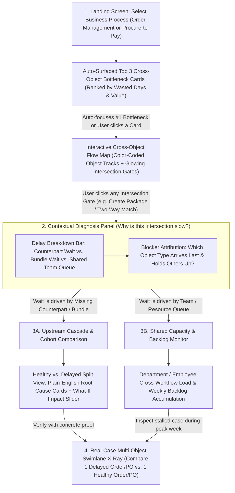

# Topic 2: Cross-Object Performance Analysis — Stakeholder, Feature & UI Flow Specification

## 1. Analysis of the Kick-Off PDF & Example Datasets

### 1.1 Project Context & Evaluation Lens
Based on [Celonis x PADS Software Lab - Kick-off WS26_27.pdf](file:///home/henri/Documents/Studium/Celonis%20Praktikum/Celonis%20x%20PADS%20Software%20Lab%20-%20Kick-off%20WS26_27.pdf), the overarching objective of the lab is concisely stated on Slide 5: **"Build an interactive tool & convince Celonis stakeholders of it."**

Understanding how your work is evaluated shapes what the product must achieve:
- **Upcoming Milestone 1 — Initial Prototype (Peer Review ~04.11, Deadline 11.11, 15 pts):** Evaluated on **Accessibility** (1 pt: minimal effort to launch, guided demo/example inputs), **User Journey** (3 pts: realistic user scenario from starting point to outcome that makes value clear), **Feature Complexity** (4 pts: well-considered combination of features addressing core Topic 2 challenges), **Next Steps & Uncertainties** (2 pts), and **Individual Q&A** (5 pts).
- **Downstream Milestones (M2 Design Doc on 06.12, Sprints 1 & 2, Final Pitch ~20.01):** Transition from an individual vision prototype into a consolidated group product pitched to Celonis stakeholders and developers.

> [!IMPORTANT]
> **The Core Product Tension to Solve:** Your audience at Celonis evaluates *both* analytical depth (Object-Centric Process Mining / OPerA rigor) and real-world customer usability. If a tool only shows basic single-object bar charts, it fails **Feature Complexity**. Conversely, if it dumps academic OCPM jargon (*"OC-DFG"*, *"Sojourn Time"*, *"Pooling Time"*, *"Mann-Whitney p-values"*) onto the screen, it fails **User Journey** for real business customers. The winning approach is **rigorous multi-object statistics under the hood, translated into zero-jargon business language and guided visual storytelling on the surface**.

---

### 1.2 Deconstructing Topic 2 (Slide 27)
Slide 27 defines the **Customer Problem** for **Cross-Object Performance Analysis**:
1. **Why traditional dashboards fail:** Evaluating business objects in isolation (looking *only* at Purchase Orders, or *only* at Invoices, or *only* at Packages) hides the real source of operational friction.
2. **Where bottlenecks actually live:** Real delays emerge at the **intersection of interacting objects**—specifically at synchronization points (where multiple objects must align before work can continue) and at **shared capacity stages** (where separate workflows compete for the same team, employee role, or inventory).
3. **The Cascade ("Domino") Effect:** Upstream delays in one object's lifecycle (e.g., purchase approval delegation or an item going out of stock) cascade into downstream lifecycles (e.g., blocked two-way invoice matching, late supplier payments, or stalled package creation).

Slide 27 also includes the visual timing model from **OPerA (*Object-Centric Performance Analysis*)** alongside five guiding questions:

| Slide 27 Guiding Question | Underlying OPerA / OCEL Concept | What It Means in Plain Business Reality |
| :--- | :--- | :--- |
| **Q1.** How do delays in one object's lifecycle impact related downstream processes? | Cross-object causal cascade / ripple propagation | *"When an upstream approval or restock slips by 2 days, how many downstream shipments or invoice payments get delayed as a result?"* |
| **Q2.** What are our most statistically significant cross-object waiting times? | Statistical bottleneck ranking across `synchronization time`, `pooling time`, and `waiting time` | *"Which multi-object handoffs reliably waste the most time (ignoring one-off flukes)?"* |
| **Q3.** How can we intuitively map these multi-object intersections to spot bottlenecks? | Object-Centric Directly-Follows Graph (OC-DFG) focused on convergence points | *"Show me clearly where separate workflows meet, and highlight which intersections are jammed."* |
| **Q4.** Where do handoffs or shared stages cause work to accumulate across lifecycles? | Queue / WIP accumulation & shared resource contention (`waiting time` vs. `service time`) | *"Are items sitting idle because a counterpart object is missing, or because a shared department (Warehouse/Finance) is overloaded?"* |
| **Q5.** How can we compare problematic cross-object interactions against healthy ones? | Cohort segmentation & statistical root-cause rule mining on OCEL attributes | *"What makes our delayed orders/payments systematically different from our smooth, on-time ones?"* |

---

### 1.3 Ground-Truth Findings from the Example Datasets
Inspecting the two OCEL 2.0 datasets in [software-lab/datasets](file:///home/henri/Documents/Studium/Celonis%20Praktikum/software-lab/datasets) via [ocel_loader.py](file:///home/henri/Documents/Studium/Celonis%20Praktikum/software-lab/ocel_common/ocel_loader.py) reveals concrete operational patterns that directly anchor your stakeholders and UI:

#### Dataset A: Order Management ([order-management.json](file:///home/henri/Documents/Studium/Celonis%20Praktikum/software-lab/datasets/order-management.json))
- **Scale & Span:** 21,008 events and 10,840 objects (Apr 2023 – Jun 2024).
- **6 Interacting Object Types:** `customers`, `orders` (2,000, with `price`), `items` (7,659, with `price`, `weight`), `products` (shared catalog), `packages` (1,128, with `weight`), and `employees` (18 staff split across `Sales` [5], `Warehousing` [7], and `Shipment` [6]).
- **Real Cross-Object Friction Patterns:**
  - **Bundle/Pooling Bottleneck at `create package`:** A single package bundles multiple `items` (on average ~6.8 items per package, sometimes consolidating across orders). While 1,544 items hit `item out of stock` $\rightarrow$ `reorder item`, the already-picked items sit waiting in staging until the last missing item is picked.
  - **Shared Capacity Contention:** The 7 `Warehousing` employees are shared across `pick item` (7,659 events), `item out of stock` / `reorder item` (3,088 events), and `create package` (1,128 events). Spikes in restocking steal capacity from packing.
  - **Downstream Ripple:** Fulfilment stalls correlate with `payment reminder` loops (566 events) and `failed delivery` incidents (311 events).

#### Dataset B: Procure-to-Pay ([ocel2-p2p.json](file:///home/henri/Documents/Studium/Celonis%20Praktikum/software-lab/datasets/ocel2-p2p.json))
- **Scale & Span:** 14,671 events and 9,543 objects (Apr 2022 – Oct 2024).
- **7 Interacting Object Types:** `material`, `purchase_requisition`, `quotation`, `purchase_order`, `goods receipt`, `invoice receipt`, and `payment`, enriched with SAP-style business attributes (`Vendor`, `Purchasing Group`, `Plant`, `Payment Block`, `Amount`, `Net Price`).
- **Shared Departmental Resources (Event Attribute `resource`):** `Finance/Account Department` (5,048 events), `Warehouse Department` (4,042), `Procurement Department` (2,525), `Procurement Order Manager` (1,598), `Manufacturing Department` (851), and `Procurement Requisition Manager` (607).
- **Real Cross-Object Friction Patterns:**
  - **Upstream Approval Loops:** `Delegate Purchase Requisition Approval` (122 cases) delays `Approve Purchase Requisition` $\rightarrow$ `Create Request for Quotation` $\rightarrow$ `Approve Purchase Order`.
  - **Multi-Object Convergence Gates:** `Perform Two-Way Match` (1,941 events) requires *both* `goods receipt` and `invoice receipt`. `Execute Payment` (1,166 events) requires **four** object types to align (`purchase_order`, `goods receipt`, `invoice receipt`, `payment`), often involving multiple partial `goods receipt` postings (4,042 total receipts!).

> [!NOTE]
> **Data Limitation Worth Highlighting in Your M1 Pitch:** Both OCEL 2.0 logs record point-in-time completion timestamps (`lifecycle = complete` in P2P; atomic timestamps in Order Management) without separate `start` timestamps. This means *synchronization*, *pooling*, and *lagging* durations between object arrivals are exact, whereas *post-synchronization delay* combines queue wait + active execution time (estimable via resource workload proxies). Mentioning this proactively directly satisfies the M1 *"Exceeds Expectations"* rubric for identifying assumptions and limitations!

---

## 2. Potential Stakeholder Profiles & Needs Analysis

To ensure the software is genuinely self-explanatory, we must design primarily for **non-technical business and operational stakeholders** who own the outcomes of these processes, plus one **semi-technical bridge role** who facilitates cross-team improvement workshops.

### Profile 1: Elena Vance — Head of Fulfillment & Warehouse Operations
- **Role Type:** Non-Technical Operational Line Manager (*Order Management & P2P Receiving*)
- **Daily Reality & KPIs:** Manages warehouse floor leads (`Warehousing` & `Shipment` teams, `Warehouse Department`). Measured on On-Time-In-Full (OTIF) shipping, packing throughput, and receiving turnaround.
- **Technical Literacy:** Uses ERP status screens and simple KPI tiles. Never uses SQL, Python, or process mining tools; finds complex node-link graphs overwhelming.
- **Core Frustrations:**
  - Gets blamed in weekly ops meetings because *"time from Order Confirmed to Create Package is 6 days"*.
  - Knows intuitively that her pickers aren't slow—boxes are sitting half-packed waiting for 1 out-of-stock product, or Finance blames her team for late Goods Receipts on split supplier deliveries—but she cannot prove it with single-object KPIs.
- **What Elena Needs from the Product:**
  - **Blameless Delay Attribution:** Clear visual separation between *"Waiting on missing/out-of-stock items"* vs. *"Waiting because Warehouse staff are busy"*.
  - **Concrete Proof:** Ability to click a bottleneck and pull up 2–3 real order/package timelines in seconds to show peers *why* packages waited.

### Profile 2: Marcus Weber — Accounts Payable & Billing Operations Lead
- **Role Type:** Non-Technical Downstream Process Owner (*P2P Finance & Order Billing*)
- **Daily Reality & KPIs:** Leads `Finance/Account Department` handling `Create Invoice Receipt`, `Perform Two-Way Match`, and `Execute Payment`. Measured on on-time supplier payment rate, captured early-payment discounts, and working capital visibility.
- **Technical Literacy:** Strong with spreadsheets and financial figures (€/\$), unfamiliar with data science or graph theory.
- **Core Frustrations:**
  - Experiences the **downstream end of every cascade**: suppliers escalate unpaid invoices, and executives ask why payments take weeks, even though Finance executes payments quickly *once* the Purchase Order, Goods Receipts, and Invoice finally match.
  - Wastes hours manually cross-checking SAP document IDs across separate tables (`EKKO`, `MSEG`, `RSEG`) to find which object blocked `Perform Two-Way Match` or `Execute Payment`.
- **What Marcus Needs from the Product:**
  - **Upstream Blocker Identification:** Instant visibility into *which object type* arrives last at `Perform Two-Way Match` and `Execute Payment` (e.g., *"In 68% of delayed payments, the Invoice arrived 5 days before the final Goods Receipt"*).
  - **Financial Impact Framing:** Bottlenecks expressed not only in hours/days, but also in **affected Order / Payment Value (€/\$)** and blocked document counts.

### Profile 3: Priya Nair — Category & Procurement Manager
- **Role Type:** Non-Technical Upstream Coordinator (*P2P Purchasing & Inventory Replenishment*)
- **Daily Reality & KPIs:** Oversees requisitions, vendor selection (`Vendor`), PO approvals, and stock replenishment (`reorder item`). Measured on supplier reliability and procurement cycle time.
- **Technical Literacy:** Business user accustomed to approval workflows and supplier scorecards.
- **Core Frustrations:**
  - Operates "blind" to downstream ripple effects: she sees that delegating a requisition approval adds 1.5 days to her stage, unaware of how that delay compounds with vendor partial deliveries to stall warehouse receiving and freeze invoice matching weeks later.
  - Struggles to know *which* vendors, purchasing groups, or product categories consistently trigger cross-object chaos versus smooth fulfillment.
- **What Priya Needs from the Product:**
  - **Downstream Ripple Visibility:** Seeing how upstream events (`Delegate Purchase Requisition Approval`, `item out of stock`) propagate into downstream delays.
  - **Healthy vs. Problematic Vendor/Category Comparison:** Plain-English comparisons showing which vendors, plants, or product lines drive disproportionate cross-object waiting times—plus a simple *"What if we cut this delay by 50%?"* impact estimate.

### Profile 4: Stefan Lindner — COO / VP of Supply Chain & Shared Services
- **Role Type:** Non-Technical Executive Decision-Maker (*Cross-Functional Budget Owner*)
- **Daily Reality & KPIs:** Oversees Procurement, Warehouse, Sales, and Finance. Has 5 minutes in an executive review to decide where to allocate budget, headcount, or policy changes.
- **Technical Literacy:** Zero tolerance for complex filter panels or technical jargon; expects immediate executive takeaways.
- **Core Frustrations:**
  - **The "Watermelon KPI" Problem:** Every department reports green siloed KPIs (*"Procurement approves POs in 24h!"*, *"Finance pays matched invoices in 8h!"*), yet end-to-end customer deliveries and supplier cycles are red because **the white space *between* objects is unowned**.
  - Cannot tell whether a backlog requires **hiring more staff** (a shared capacity problem) or **fixing a handoff rule** (a synchronization/batching policy problem).
- **What Stefan Needs from the Product:**
  - **Zero-Click Executive Triage:** Top 3 cross-object bottlenecks ranked automatically on the landing screen in plain business English.
  - **Investment Lever Clarity:** Immediate distinction between **Synchronization/Policy Friction** (fix handoff/batching rules) and **Capacity Friction** (reallocate/hire staff in overloaded shared departments).

### Profile 5: Lukas Meyer — Operational Excellence Lead (Internal Celonis Champion)
- **Role Type:** Semi-Technical Business Analyst / Workshop Facilitator (*Bridge Persona*)
- **Daily Reality & KPIs:** Prepares cross-departmental process improvement workshops for Stefan, Elena, Marcus, and Priya.
- **Technical Literacy:** Understands KPIs, cohorts, and basic process flows, but is **not** an academic process-mining researcher.
- **Core Frustrations:**
  - Needs **statistical credibility** so department heads don't dismiss findings as "cherry-picked outliers," yet cannot show p-values or raw OC-DFG hairballs in a workshop without losing the room.
- **What Lukas Needs from the Product:**
  - **Automatic Statistical Noise Filtering:** The tool automatically hides insignificant small-sample anomalies and badges findings with clear confidence & sample-size indicators (*"High Confidence • Based on 1,128 packages"*).
  - **Seamless Drill-Down Flow:** Ability to move smoothly in one live meeting from high-level map $\rightarrow$ root-cause comparison $\rightarrow$ individual case timeline without switching tools or writing queries.

---

### 2.1 Synthesis: Stakeholder-to-Requirement Matrix

| Stakeholder | Primary Question They Ask the Tool | Key Metric / Lens Needed | Biggest UX Dealbreaker to Avoid |
| :--- | :--- | :--- | :--- |
| **Stefan (COO)** | *"Where are our top 3 cross-department choke points right now, and do I fix policy or headcount?"* | End-to-end wasted days, € value stalled, Sync vs. Capacity split | Having to configure 6 sidebar dropdowns before seeing an insight |
| **Elena (Warehouse)** | *"Are packages late because my team is slow, or because we're waiting on out-of-stock items?"* | Bundle/Item wait vs. Team queue wait; concrete package timelines | Unreadable "spaghetti" process graphs with 40 crossing arrows |
| **Marcus (Finance)** | *"Which missing counterpart object is holding up Two-Way Match and Payment?"* | Straggler attribution (% held up by GR vs. PO vs. Invoice) + € blocked | Single-object metrics that blame the final step for upstream lag |
| **Priya (Procurement)** | *"How do upstream approval/stock delays cascade downstream, and which vendors/items are worst?"* | Upstream-to-downstream cascade multiplier + Healthy vs. Delayed drivers | Raw statistical test names (*Mann-Whitney U*, *p = 0.0003*) |
| **Lukas (OpEx Lead)** | *"Are these bottlenecks statistically real, and can I walk stakeholders from macro pattern to real case?"* | Sample count, confidence badge, cohort delta, 1-click case drill-down | Disconnected tabs that lose filter context between views |

---

## 3. Central Features That Must 100% Be Included

To address every facet of Slide 27 while serving the five stakeholders above, the software must encompass **seven fundamental features**, unified by a **Plain-Language Translation Layer** that replaces academic OPerA terms with self-explanatory business concepts:

> [!TIP]
> **Built-In Vocabulary Translation (Academic Rigor $\rightarrow$ Self-Explanatory UI):**
> - *Synchronization Time* $\rightarrow$ **"Counterpart Wait"** *(waiting for another object type, e.g., Invoice waiting for Goods Receipt)*
> - *Pooling Time* $\rightarrow$ **"Bundle Completion Wait"** *(waiting for all items of the same type, e.g., 5th item of a package)*
> - *Lagging Object / Time* $\rightarrow$ **"Primary Blocker"** *(which object arrives last and holds everyone else up)*
> - *Post-Sync Waiting Time* $\rightarrow$ **"Team / Capacity Queue"** *(all objects ready, waiting for a shared team/employee)*
> - *OC-DFG* $\rightarrow$ **"Cross-Object Flow Map"** *(clean visual map of where object lifecycles meet)*
> *(Tip: Keep the formal OPerA terms inside subtle `(i)` hover tooltips so Celonis engineers/graders immediately recognize the theoretical foundation!)*

### Feature 1: Automated "Top Cross-Object Bottlenecks" Triage Banner
- **What it does:** Immediately upon opening a dataset, the backend statistically evaluates all multi-object activities and surfaces the **Top 3 statistically significant cross-object friction points** as plain-English summary cards at the top of the screen, ranked by total wasted object-days (and €/\$ value where available).
- **Example Card:** *"🔴 #1 Bottleneck: **Create Package** — Avg. **4.2 days** Counterpart/Bundle Wait across **1,128 packages**. Primary Blocker: Out-of-Stock **Items** (64% of delays)."*
- **Why 100% required:** Eliminates "blank-canvas paralysis" for Stefan, Elena, and Marcus (Slide 27 Q2). Clicking any card focuses the entire dashboard on that bottleneck in one click.

### Feature 2: Simplified Cross-Object Flow & Intersection Map
- **What it does:** Displays an intuitive, decluttered visual map showing object types as distinct color-coded tracks/streams (e.g., Blue = `Orders`, Amber = `Items`, Emerald = `Packages`; or `Purchase Order`, `Goods Receipt`, `Invoice`) converging at highlighted **Intersection Gates** (multi-object activities like `create package`, `Perform Two-Way Match`, `Execute Payment`).
- **Self-Explanatory Visual Encoding:**
  - Single-object steps are compact and muted so **multi-object intersections visually pop**.
  - Incoming edges to an intersection are color/thickness-coded by **who holds whom up** (a thick pulsing amber edge from `Items` into `Create Package` immediately shows that `Items` are the straggler, while `Orders` arrive early).
  - Includes a single **"Map Simplicity" slider** (*Key Flows Only* by default $\leftrightarrow$ *All Exceptions*) to prevent spaghetti graphs.
- **Why 100% required:** Directly answers Slide 27 Q3 (*"intuitively map these multi-object intersections to spot bottlenecks"*).

### Feature 3: "Why Are We Waiting?" Delay Decomposition & Blocker Attribution
- **What it does:** When a user selects any Intersection Gate, a clean **Delay Breakdown Bar** splits the total pre-execution delay into three unmistakable buckets:
  1. **Waiting on Another Object Type** (*Synchronization*)
  2. **Waiting to Complete a Multi-Item Bundle** (*Pooling*)
  3. **Waiting on Shared Team / Resource Capacity** (*Post-Sync Queue / Turnaround*)
- Directly underneath, a **"Who Arrives Last? (Blocker Ranking)"** horizontal bar chart ranks the participating object types by how often they are the final straggler holding up the step, and by how many hours/days they lag behind already-waiting counterparts.
- **Why 100% required:** Resolves departmental finger-pointing for Elena, Marcus, and Stefan by turning OPerA's core metrics into an actionable diagnosis (*Policy/Alignment issue vs. Staffing/Capacity issue*).

### Feature 4: Upstream-to-Downstream Cascade ("Domino Effect") Tracer
- **What it does:** Allows users to select an upstream friction event or delay (e.g., `item out of stock` / `reorder item` in Order Management, or `Delegate Purchase Requisition Approval` / late `Approve Purchase Order` in P2P) and visually trace its **downstream ripple** across connected objects.
- Displays a clean **Domino Impact Chain**: *"When an Order has $\ge 1$ Out-of-Stock Item $\rightarrow$ Package Creation slips by **+3.8 days** $\rightarrow$ Payment Reminders increase by **2.1×**."*
- **Why 100% required:** Directly answers Slide 27's opening thesis and Q1 (*"How do delays in one object's lifecycle impact related downstream processes?"*).

### Feature 5: Shared Capacity & Backlog Accumulation Monitor
- **What it does:** Visualizes **where work piles up over time** across object lifecycles and **how shared teams/resources split their capacity** across competing workflows.
- Combines two linked, easy-to-read charts:
  1. **Shared Team Load Matrix / Bar:** Shows each department or role (e.g., `Warehousing` employees, `Finance/Account Department`, `Warehouse Department`) and which activities/object types consume their capacity—highlighting stages where high team utilization coincides with long post-sync waiting times.
  2. **Backlog Accumulation Trend:** A timeline showing how stalled objects (e.g., confirmed orders waiting to be packed, or received goods waiting for invoice match) accumulate into backlogs during peak load weeks.
- **Why 100% required:** Directly answers Slide 27 Q4 (*"Where do handoffs or shared stages cause work to accumulate across lifecycles?"*).

### Feature 6: "Healthy vs. Delayed" Cohort Comparison & Root-Cause Cards
- **What it does:** Automatically divides business cases (e.g., `orders` or `purchase_order` clusters) into **Healthy (On-Time)** vs. **Problematic (Delayed)** based on an intuitive threshold slider (defaulting intelligently to the slowest 25% or a clear SLA target in days).
- Runs statistical tests + rule mining in the background and presents the top differentiators as **Plain-English Root-Cause Cards** with side-by-side comparison bars:
  - Example: *"Orders with **> 4 items** AND **at least 1 restocked product** experience **3.1× longer** package synchronization wait (Avg. 5.6d vs. 1.8d in healthy orders) • `[High Statistical Confidence | n = 482]`."*
  - Includes a lightweight **1-Slider Impact Estimator** (*"What if we reduce this blocker delay by 30%? $\rightarrow$ Est. X fewer delayed orders & €Y unlocked faster"*).
- **Why 100% required:** Directly answers Slide 27 Q5 (*"How can we compare problematic cross-object interactions against healthy ones?"*) while empowering Priya, Stefan, and Lukas to justify concrete interventions.

### Feature 7: Real-Case "Multi-Object Timeline X-Ray"
- **What it does:** From any bottleneck or comparison cohort, clicking **"Inspect Real Example"** opens a side-by-side or single-case **Horizontal Swimlane Timeline** for one concrete business cluster (e.g., `Order #1042` + its 4 `Items` + `Package #318` + `Employees`, or `PO #450012` + its 3 `Goods Receipts` + `Invoice #9011` + `Payment`).
- Visually shades the exact **red waiting gap** where early-arriving objects sat idle waiting for the lagging blocker object.
- **Why 100% required:** Non-technical managers trust statistics only when they can verify them on an intuitive, real-world story they recognize. It makes the entire concept of "cross-object influence" click within 10 seconds.

---

## 4. Self-Explanatory UI Architecture & Basic User Flow

### 4.1 Core UX Principles Making the UI Self-Explanatory
1. **Progressive Disclosure ("Macro $\rightarrow$ Diagnosis $\rightarrow$ Action $\rightarrow$ Proof"):** Never show every chart at once. Start with the big picture (Triage Cards + Cross-Object Map), reveal deeper diagnostics dynamically when an intersection is clicked, and allow effortless drill-down into cohort comparison and a real case X-ray.
2. **Question-Driven Navigation Instead of Technical Tabs:** Label navigation steps as the exact questions a manager asks:
   - **1. Spot Bottlenecks** *(Overview & Cross-Object Map)*
   - **2. Diagnose Cause & Capacity** *(Counterpart Wait vs. Shared Team Load)*
   - **3. Compare Healthy vs. Delayed** *(Root Causes & Ripple Impact)*
   - **4. Inspect Real Case Story** *(Single-Case Swimlane X-Ray)*
3. **Direct Click-to-Focus + Persistent Context Pill:** Clicking a Top Bottleneck Card or clicking a glowing node on the map updates the active focus everywhere, displayed clearly in a top breadcrumb bar:
   `Process: Order Management  ▸  Focused Intersection: Create Package  [Clear Focus ×]`
4. **Contextual Empty/Default States:** Even before clicking anything, the tool pre-selects the **#1 most severe cross-object bottleneck** so every panel immediately shows meaningful, connected data with a clear callout explaining *why* it was auto-selected.

---

### 4.2 End-to-End Stakeholder UI Flow



---

### 4.3 Screen Layout & Step-by-Step Interaction Walkthrough

Below is the spatial UI blueprint illustrating how a non-technical user naturally flows through the application without needing a manual:

```text
+---------------------------------------------------------------------------------------------------+
| [Process: Order Management v]   [Timeframe: All Data v]   [Simplicity: Key Flows o--- All]  [? Help] |
| Active Focus: #1 Bottleneck -> "Create Package" (1,128 packages)                 [Reset Focus x]  |
+---------------------------------------------------------------------------------------------------+
|  TOP CROSS-OBJECT FRICTION SPOTLIGHT (Click any card to focus)                                    |
|  +-------------------------------+ +-------------------------------+ +--------------------------+ |
|  | #1 CREATE PACKAGE     [Active]| | #2 PAY ORDER                  | | #3 PACKAGE DELIVERED     | |
|  | 4.2d avg wait | €310k stalled | | 2.9d avg wait | 566 reminders | | 1.8d wait | 311 failed   | |
|  | Main Blocker: Items (OutStock)| | Main Blocker: Delivery lag    | | Shared: Shipment Staff   | |
|  +-------------------------------+ +-------------------------------+ +--------------------------+ |
+---------------------------------------------------------------------------------------------------+
|  [1. Map & Diagnosis]   [2. Shared Team Capacity & Backlogs]   [3. Healthy vs Delayed & X-Ray]    |
+-----------------------------------------------------------------+---------------------------------+
|  CROSS-OBJECT FLOW MAP (Color-coded tracks meet at Gates)       |  INTERSECTION DIAGNOSIS         |
|                                                                 |  Gate: CREATE PACKAGE           |
|   (Customers/Orders) -----[Place Order]---->[Confirm Order]--+  |                                 |
|                                                              |  |  Why do objects wait here?      |
|   (Items/Products)   --[Pick Item]--+-->[Out of Stock]       |  |  [===========|====|===] 5.1d    |
|                                     |     v                  v  |   62% Bundle  23%  15% Team     |
|                                     +<-[Reorder]=====>(( CREATE |       Wait   Sync   Queue       |
|                                                        PACKAGE))|                                 |
|   (Employees: Warehousing) ----------------------------^  |     |  Who holds up this step?        |
|                                                           v     |  Items (Restocked) [========]74%|
|   (Packages) ------------------------------------>[Send Package]|  Warehousing Staff [===]     26%|
|                                                                 |                                 |
|  *Thick pulsing amber arrow = Primary Blocker holding up gate   |  [Trace Upstream Domino Effect] |
|                                                                 |  [Compare Healthy vs Delayed ->]|
|                                                                 |  [Inspect Real Order X-Ray   ->] |
+-----------------------------------------------------------------+---------------------------------+
```

#### Step-by-Step User Walkthrough:
1. **Zero-Effort Orientation (0–10 seconds):**
   - The stakeholder opens the app. Without touching a single filter, the **Top Cross-Object Friction Spotlight** highlights the 3 biggest cross-object bottlenecks in plain English, and pre-selects `#1` on the **Cross-Object Flow Map**.
   - Color-coded legends at the top of the map show each participating object type (e.g., `Orders`, `Items`, `Packages`, `Employees`), immediately orienting the user that *multiple lifecycles run in parallel and meet at glowing gates*.
2. **Visual Bottleneck Discovery & Diagnosis (10–30 seconds):**
   - Looking at the glowing `Create Package` gate (or clicking `Perform Two-Way Match` / `Execute Payment` in P2P), the right-hand **Intersection Diagnosis** panel automatically answers *"Why do objects wait here?"*
   - The stacked bar clearly separates **Counterpart/Bundle Wait** (an object alignment problem) from **Team Queue** (a shared staffing problem), while **"Who holds up this step?"** names the exact lagging object type.
   - Clicking **"Trace Upstream Domino Effect"** highlights the upstream path (e.g., `item out of stock` $\rightarrow$ `reorder item`, or `Delegate Purchase Requisition Approval`) and displays a plain-English callout quantifying how that upstream hiccup multiplies downstream waiting time.
3. **Checking Shared Capacity & Work Accumulation (30–60 seconds):**
   - If the Diagnosis Bar shows significant **Team Queue** delay—or if Elena/Stefan clicks Step 2 (**Shared Team Capacity & Backlogs**)—the view shows how shared departments/roles (`Warehousing` staff, `Finance/Account Department`, `Warehouse Department`) split their workload across competing activities, paired with a weekly chart showing *where and when* stalled work accumulates into backlogs.
4. **Comparing Healthy vs. Delayed & Testing Impact (60–90 seconds):**
   - Clicking **"Compare Healthy vs. Delayed $\rightarrow$"** (Step 3) presents a clean split comparison between smooth cases and delayed cases.
   - Auto-discovered **Root-Cause Cards** highlight the strongest business drivers (e.g., specific Vendors, Purchasing Groups, order item counts, or out-of-stock exposure) with confidence badges. Moving the **What-If Impact Slider** (*"Reduce restock/approval delay by 40%"*) immediately previews how many delayed orders/payments and €/\$ in stalled value would recover.
5. **Closing the Loop with a Real-Case X-Ray (90–120 seconds):**
   - Finally, clicking **"Inspect Real Order/PO X-Ray $\rightarrow$"** opens a horizontal multi-object timeline comparing one representative delayed case against one healthy case. Every object (`Order`, each `Item`, `Package`, `Employee`) sits on its own swimlane, with a shaded red band marking the exact days early items sat waiting for the lagging item—giving the stakeholder undeniable, self-explanatory visual proof to take straight into an operational decision.
